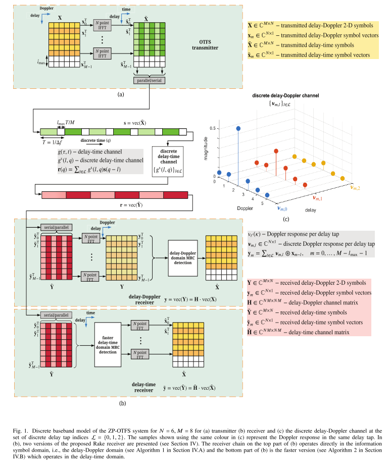
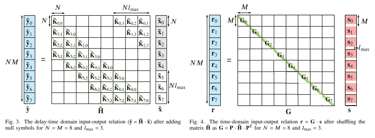
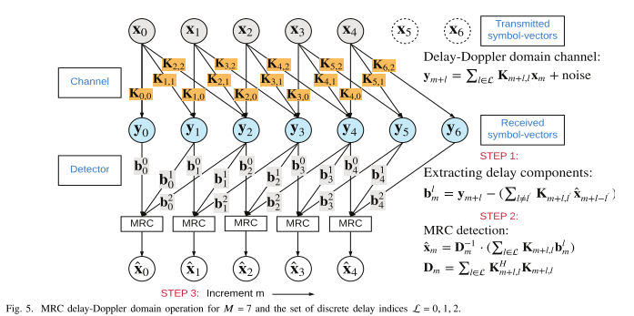
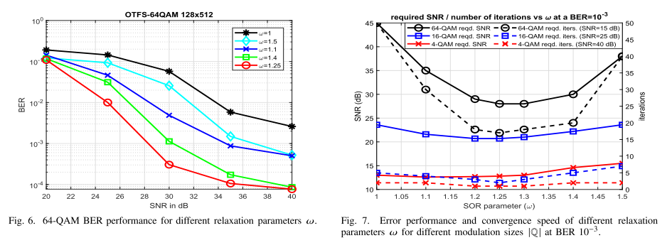
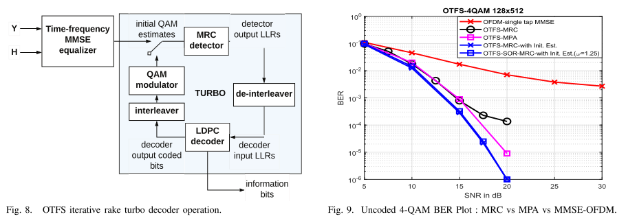
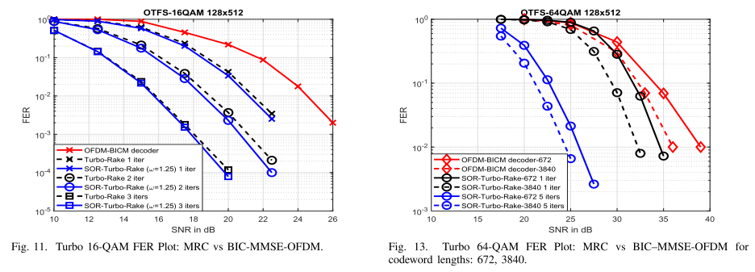
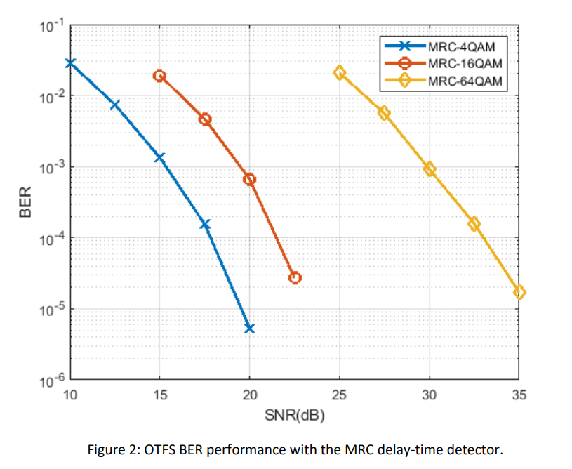
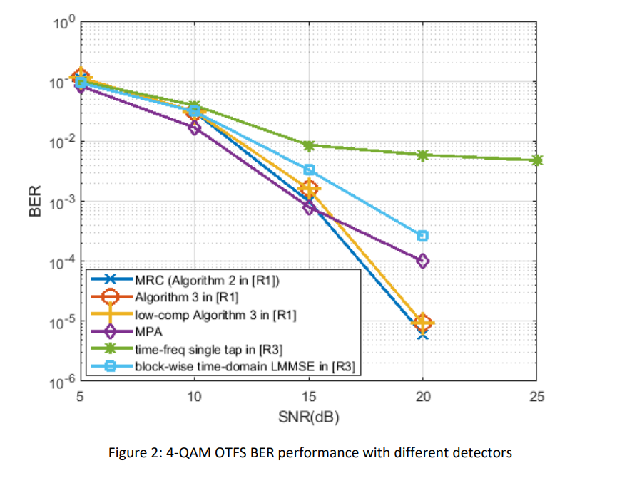

# Signal Detection: Low-Complexity Iterative Rake Decision Feedback Algorithm for Zero-Padding OTF System with MATLAB Code

Introduction Orthogonal Time-Frequency and Spatial (OTFS) is a new two-dimensional (2D) modulation technique that achieves maximum effective 1-diversity by expanding all information symbols (e.g., QAM), [1] [2]. As a result, due to multipath fading and mobility, time-frequency selective channels are converted into separable and quasi-orthogonal interactions where all received information symbols experience approximately the same local impairment [1]. Consequently, for each use of an information symbol, all received components in the delay Doppler diversity branches can be separated and coherently combined.
OTFS can also be interpreted as a QR code multiple access (CDMA) scheme where information symbols are both time and frequency extended, differing from traditional CDMA systems [1]. In direct sequence CDMA operating in multipath fading channels, the Ricker receiver operates by combining the delayed component of the transmitted coded symbols (or echoes) using a matching filter tuned to the corresponding delay shift. Similarly, in the case of OTFS, linear diversity combination techniques can be used to extract and coherently combine the received delayed and Doppler shifted components of the transmitted information symbols, improving the cumulative signal SNR. Starting with Brennan's paper on linear diversity combining, the technology has been well studied in the literature [4]. The Rake receiver for time domain combination was discussed in [5] and [6] using various linear combination schemes such as maximum ratio combining (MRC), equal gain combining (EGC), and selection combining (SC). MRC is shown to be optimal in both correlated and uncorrelated branches even when the noise and interference power in the branches are unequal [7]. Moreover, iterative rake combining schemes and their variants have been shown to better combat inter-symbol interference and have been well studied in the CDMA system literature [8].
In this paper, we propose an iterative RAKE receiver OTFS system using the maximum ratio combining scheme. Following [3], we group delay-Doppler grid symbols into vectors based on their delay index and redefine the input-output relationship between transmission and reception frames according to these transmitted and received vectors. By placing some null symbols (zero-padding (ZP)) in the delay-Doppler domain, we achieve a reduced input-output relationship, which allows the design of low-complexity detectors for OTFS using maximum ratio combination. The overhead required for the proposed detection scheme with null protection symbols also allows the insertion of pilot symbols without additional costs [10]. These null symbols in the delay-Doppler domain serve as time-domain interleaved ZP guard bands. Leveraging this interleaving in the time domain ZP, we further propose an alternative low-complexity OTFS detection based on time-domain MRC. The OTFS with the described ZP guard band is similar to the recently proposed Doppler Elastically Orthogonal Signal Division Multiplexing (D-OSDM) scheme [11]. For underwater acoustic channels [12], compared to the vehicle channel model assumption [13], it is modeled as relatively faster time-varying. Even though information symbols are sent in the delay-Doppler domain in both schemes, the main advantage of the general OTFS transceiver structure is providing the insertion of arbitrary frequency-domain windows, which is not part of the D-OSDM scheme. The windowing allows OTFS to select subsets of subcarriers for transmission and reception, which is particularly useful in multi-user communication schemes.
The article illustration.
Conclusion Based on the maximum ratio combining principle, this paper re-derives the OTFS input-output relationship and proposes two linear complexity iterative RAKE detection algorithms suitable for ZP-OTFS modulation. We show that MRC detectors can achieve similar or better bit error rate (BER) performance than MPA detectors with lower complexity and storage requirements. On the basis of the Gauss-Seidel method, a successive over-relaxation parameter is introduced to improve the detector's error performance and faster convergence speed. The performance of MRC detectors is further enhanced by an external error control coding scheme using Turbo iteration. Another advantage of the MRC detector is its linear relationship between complexity and delay taps (delayed taps), rather than total number of paths (total number of paths), which is attributed to the 2-D convolution and vector decomposition of the channel.
MATLAB Simulation Results

## Images

<!-- PAYMENT_BLOCK -->

## Get this dataset

- Payment link (Stripe): [Buy now](https://buy.stripe.com/3cs8yP7sY87d0vu9AB)
- Payment QR code: 

<!-- /PAYMENT_BLOCK -->
